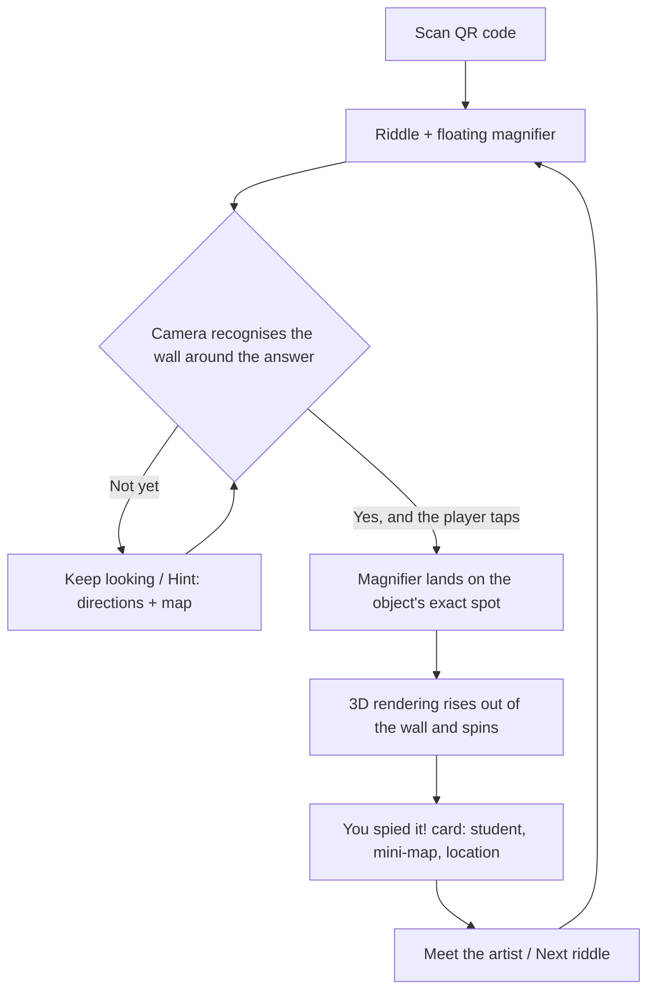

# How the AR works

## What the visitor experiences

1. **Scan the QR code** next to the mural. The game opens in the phone's browser.
2. **Read the riddle.** A magnifying glass floats over the camera view.
3. **Point the phone at the wall.** The app only looks for the patch of wall around the answer. Anywhere else, nothing
   happens; **Hint** gives written directions and a small map of the wall with a gold search area.
   - **The answer's patch comes into view:** the magnifying glass glows. When the player taps, it **flies onto the object**
     and becomes a lens in AR, framing the exact spot on the wall. A **3D rendering of the object** then rises out of the
     lens and **spins** in front of the wall ([3d-models.md](3d-models.md)).
   - **The patch is in view but the object is off screen:** "Nope, not in view."
4. **"You spied it!"** About a second later, a card shows the object's name, the student who made it, a **mini-map of the
   whole wall** with the spot circled, and where it is in words: *"Right side of the mural: 9th panel from the left, top row"*.
5. **Meet the artist** opens the student's page. **Next riddle** continues the game.

## How the app knows where everything is

Everything has a **position on the mural, in inches from the top-left corner of the painted area** (x to the right, y down).
The wall is about 576 × 144 in, in 48 in panels.

There are three kinds of things with positions, all in [`data/objects.json`](../data/objects.json):

| | What it is | Example |
| --- | --- | --- |
| **Targets** | Each object's own patches of wall the camera can recognise, in `ar` on the object and compiled into `targets/objects/<id>.mind` | `"ar": { "mind": "targets/objects/boombox.mind", "targets": [{ "x": 297, "y": 51, "w": 25, "h": 25 }] }` |
| **Landmarks** | Fixed things everyone can see, i.e. the windows. Used for directions, never for recognition | `{ "name": "the middle window", "x": 224, "y": 0, "w": 64, "h": 144 }` |
| **Objects** | The things people hunt for, each with a tight box around it | `"location": { "x": 300, "y": 12, "w": 9, "h": 14 }` |

When the camera recognises a target, MindAR tells us where that target is in 3D. Because we know where the target is on the
wall **and** where the object is on the wall, we can:

- tell whether the answer is on screen when the player taps,
- put the lens and the spinning 3D rendering **exactly on the object**, not just "somewhere on the target",
- draw the mini-map and the "9th panel from the left, top row" description.

All of it comes from one straight-on image of the painted wall, made from LiDAR scans, and
[`tools/wall/build.py`](../tools/wall/build.py) ([adding-an-object.md](adding-an-object.md)).

### Windows

The real **windows in the wall** are the easiest landmarks of all. Everyone can see them, and they never move. They're
stored as `landmarks` in `objects.json` (`{ "name": "the middle window", "x": …, "y": …, "w": …, "h": … }`) and used to:

- **give directions players can follow:** *"Not here. Try about 9 ft to the right, just left of the middle window."*
- **describe where the answer was:** *"Just left of the middle window: 5th panel from the left, top row"* (when the object
  is within about 6 ft of a window; otherwise it falls back to panels only),
- **orient the mini-map,** where windows show as sky-blue blocks.

Name each window the way players would say it, like "the middle window" or "the tall window on the left". The name is
dropped straight into sentences.

Glass reflects people and lights, and the view through it changes all day, so the camera can't learn it. Targets around
objects next to a window include some glass; the painted detail around it does the work.

### The panel grid on the wall

The 48 in panel lines are **visible on the wall itself**, which helps in three ways:

- **Measuring:** the wall scan is calibrated off the seams (`calibration` in [`tools/wall/wall.json`](../tools/wall/wall.json)),
  so positions are in true inches. On site, any position can be checked with a tape measure from the nearest seam.
- **Directions for players:** the found card says *"9th panel from the left, top row"*, and the mini-map shows the same
  grid, so people can count along the real seams.

One caution: every grid crossing looks the same, so the seams can't tell the camera *which* panel it's looking at. The
painting has to do that, so each target needs plenty of artwork in it, not just lines.

## Why one target per object

MindAR recognises **natural features**: corners, edges and texture in the painting itself. Three things about this wall
decided how the targets are cut:

- **It's a hallway.** Players stand 2 to 3 ft back, so a phone held upright sees only about 2 × 3½ ft of wall. Big
  panel-sized targets never fill the view, so each object gets a square of wall about 1.6 times its size (0.5 to 1.1 m).
- **Detail matters more than size.** Targets are compiled at twice the resolution we started with. In simulated close-up
  views, the old resolution found 13 views in 60; the new one, 51.
- **The top row is 8 to 12 ft up**, and from 2 ft away the phone tips up 55 to 70°. Recognition falls apart past about 45°,
  so objects high on the wall also get two copies pre-tilted the way the wall looks from below. That took steep upward
  views from 15 in 51 to 37 in 51. The top right corner (about 3.4 m up) is still the hardest place to play.

**The game loads only the current riddle's targets.** All of them together are about 27 MB and would be slow to search on
a phone. One object's are 0.2 to 1 MB, recognition starts quickly, and the wrong object can never match. The trade-off:
pointing at the wrong object shows nothing, rather than telling the player what they're looking at.

Other things to plan around:

- **Lighting and glare.** Matte varnish helps a lot. Test in the light the wall actually gets, at different times of day.
- **The painting changes, the targets don't.** Anything repainted after the scan needs a rescan and rebuild.

## Markers

We decided against AprilTags or other printed markers: the painting alone recognises well with per-object targets, and
markers would have had to be painted into the art. If the top right corner proves too hard in practice, a marker designed
into the scenery up there (a framed picture, a label) is the fallback.

## Settings you can tune

At the top of [`js/app.js`](../js/app.js):

| Setting | Default | What it does |
| --- | --- | --- |
| `WRONG_SCANS_BEFORE_ARROW` | 3 | Wrong spots before the arrow appears (a hint shows it straight away) |
| `MIN_OVERLAP` | 0.6 | How much of an object must be inside a target to count as "in view" |
| `MAX_TARGETS` | 3 | Target slots per riddle (a straight-on target plus two pre-tilted ones) |
| `CARD_DELAY_MS` | 2600 | Time to enjoy the 3D rendering before the "You spied it!" card appears |
| `SHEET_TIMEOUT_MS` | 5000 | How long to wait for the riddle sheet before using the backup riddles |
| `SPIN_MS` (in [`js/popout.js`](../js/popout.js)) | 6000 | How long one full turn of a 3D rendering takes |

## Testing plan

1. **At your desk:** point your phone at the wall picture on a laptop, or play the no-camera mode
   ([testing-without-the-wall.md](testing-without-the-wall.md)).
2. **On the finished wall:** iPhone and Android; morning, afternoon and evening light; standing close and far; the top
   row from the floor; two people playing at once.
