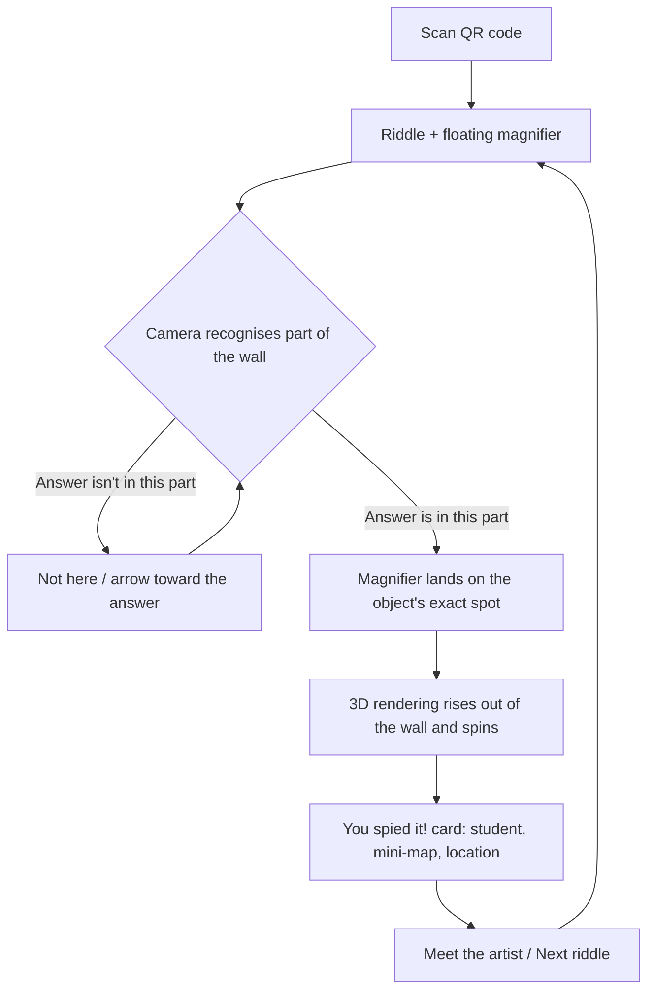

# How the AR works

## What the visitor experiences

1. **Scan the QR code** next to the mural. The game opens in the phone's browser.
2. **Read the riddle.** A magnifying glass floats over the camera view.
3. **Point the phone at the wall.** The app works out which part of the mural it's looking at.
   - **Wrong part of the wall:** "Good eye, but it's not here." After three wrong spots, or if they tap **Hint**, an arrow
     and a direction appear: *"Try about 9 ft to the right and higher up."*
   - **Right part of the wall:** the magnifying glass **flies onto the object** and becomes a lens in AR, framing the
     exact spot on the wall. A **3D rendering of the object** then rises out of the lens and **spins** in front of the wall
     ([3d-models.md](3d-models.md)).
4. **"You spied it!"** About a second later, a card shows the object's name, the student who made it, a **mini-map of the
   whole wall** with the spot circled, and where it is in words: *"Right side of the mural: 9th panel from the left, top row"*.
5. **Meet the artist** opens the student's page. **Next riddle** continues the game.

## How the app knows where everything is

Everything has a **position on the mural, in inches from the top-left corner of the painted area** (x to the right, y down).
The wall is about 576 × 144 in, in 48 in panels.

There are three kinds of things with positions, all in [`data/objects.json`](../data/objects.json):

| | What it is | Example |
| --- | --- | --- |
| **Targets** | Parts of the mural the camera can recognise. Each is one image in `targets/targets.mind`, in order | `{ "index": 0, "x": 288, "y": 0, "w": 48, "h": 48 }` |
| **Landmarks** | Fixed things everyone can see, i.e. the windows. Used for directions, never for recognition | `{ "name": "the middle window", "x": 224, "y": 0, "w": 64, "h": 144 }` |
| **Objects** | The things people hunt for, each with a tight box around it | `"location": { "x": 300, "y": 12, "w": 9, "h": 14 }` |

When the camera recognises a target, MindAR tells us where that target is in 3D. Because we know where the target is on the
wall **and** where the object is on the wall, we can:

- tell whether the answer is in view (most of its box is inside the target),
- put the lens and the spinning 3D rendering **exactly on the object**, not just "somewhere on the target",
- point the player toward the answer when it's somewhere else, and say roughly how far,
- draw the mini-map and the "9th panel from the left, top row" description.

Targets and objects are **independent**. One target can contain many objects, and the target layout can change without
touching any object. The [position marking tool](../tools/locate.html) produces both from a straight-on photo of the wall.

### Windows

The real **windows in the wall** are the easiest landmarks of all. Everyone can see them, and they never move. They're
stored as `landmarks` in `objects.json` (`{ "name": "the middle window", "x": …, "y": …, "w": …, "h": … }`) and used to:

- **give directions players can follow:** *"Not here. Try about 9 ft to the right, just left of the middle window."*
- **describe where the answer was:** *"Just left of the middle window: 5th panel from the left, top row"* (when the object
  is within about 6 ft of a window; otherwise it falls back to panels only),
- **orient the mini-map,** where windows show as sky-blue blocks.

Name each window the way players would say it, like "the middle window" or "the tall window on the left". The name is
dropped straight into sentences.

**Keep windows out of AR targets.** Glass reflects people and lights, and the view through it changes all day, so the
camera can't learn it. The marking tool warns when a target box covers a window.

### The panel grid on the wall

The 48 in panel lines are **visible on the wall itself**, which helps in three ways:

- **Measuring:** in the [marking tool](../tools/locate.html), the panel grid it draws should sit exactly on the seams in your
  photo. If it doesn't, the wall edge is off or the photo is crooked. On site, any position can be checked with a tape
  measure from the nearest seam.
- **Directions for players:** the found card says *"9th panel from the left, top row"*, and the mini-map shows the same
  grid, so people can count along the real seams.
- **Cutting targets:** cut targets along the seams, with some overlap (see below).

One caution: every grid crossing looks the same, so the seams can't tell the camera *which* panel it's looking at. The
painting has to do that, so each target needs plenty of artwork in it, not just lines.

## Choosing targets

MindAR recognises **natural features**: corners, edges and texture in the painting itself. The mural's thick ink outlines and
busy shelves suit this well. What matters is how the targets are cut up:

| Option | Good | Bad |
| --- | --- | --- |
| **One target per object** (a crop around each thing) | Very precise | ~80 small targets; people have to stand close; slow to search through |
| **One target per 48 in panel** (cut on the seams) | Few targets; works from a few feet away | Objects near a seam may not count as "in view" |
| **Panel-sized targets that overlap by about a third** ⭐ | Whatever you look at, one target is fully in view | A few more targets to compile |

**Recommendation:** start with overlapping, panel-sized targets, only covering areas that have riddle objects, and test on
the real wall. Split a busy area into smaller targets if it's hard to recognise.

Other things to plan around:

- **Distance.** A phone held upright sees a 4 ft panel from about 4 to 5 ft away. Visitors will naturally stand there.
- **The top row is 8 to 12 ft up.** It's seen at an angle, and recognition gets worse past about 45°. Use bigger targets up high.
- **Lighting and glare.** Matte varnish helps a lot. Test in the light the wall actually gets, at different times of day.
- **Recognition only works on the finished painting.** Every target must be photographed after painting is done.

## Do we need AprilTags (or other markers)?

**Probably not, but it has to be decided before the wall is painted.**

AprilTags, ArUco and QR-style markers are black-and-white squares that cameras find very reliably and very precisely.

| | Markers (AprilTags etc.) | The painting itself (what we do now) |
| --- | --- | --- |
| Reliability | Excellent, even in poor light and at angles | Good on detailed art; weak on plain areas (sky, white gaps) and useless on window glass |
| Precision | Exact position from one marker | Good once a target is recognised |
| Look | Visible black squares on the art | Invisible, the art is untouched |
| Coverage | Need roughly one per panel so one is always in view (~36) | Covered by how we cut up the targets |
| Code | MindAR doesn't support them; needs a different detector library | Already built |

**If we do use markers,** they shouldn't look like stickers. Design them into the mural as I Spy objects, like framed pictures
on the wall, crates or labels with the pattern printed on them. The art team would need to plan for them now. In the code,
markers would just be more targets with a position on the wall, so the rest of the system stays the same.

**Suggested test before deciding:** print one panel of the final art at quarter scale, compile it as a target, and try it
at a quarter of the real distance (recognition doesn't care about scale). If it's found quickly and holds steady, skip the
markers.

## Settings you can tune

At the top of [`js/app.js`](../js/app.js):

| Setting | Default | What it does |
| --- | --- | --- |
| `WRONG_SCANS_BEFORE_ARROW` | 3 | Wrong spots before the arrow appears (a hint shows it straight away) |
| `MIN_OVERLAP` | 0.6 | How much of an object must be inside a target to count as "in view" |
| `CARD_DELAY_MS` | 1200 | Time to enjoy the 3D rendering before the "You spied it!" card appears |
| `SHEET_TIMEOUT_MS` | 5000 | How long to wait for the riddle sheet before using the backup riddles |
| `SPIN_MS` (in [`js/popout.js`](../js/popout.js)) | 6000 | How long one full turn of a 3D rendering takes |

## Testing plan

1. **At your desk:** open the demo card ([`targets/source/00-demo-card.png`](../targets/source/00-demo-card.png)) on a laptop
   and point your phone at the live site.
2. **Before painting:** the quarter-scale print test above.
3. **On the finished wall:** iPhone and Android; morning, afternoon and evening light; standing close and far; the top
   row from the floor; two people playing at once.
