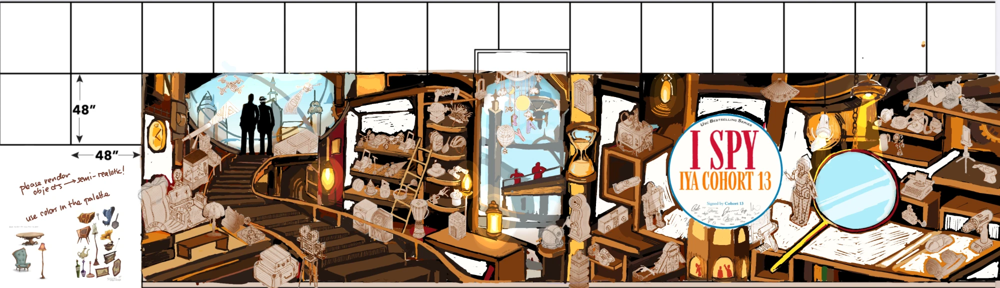

# Mural reference

The concept art for the IYA Cohort 13 I Spy mural. Everything in the AR experience (look, colours, the objects people hunt for) should follow this.
It's a **reference only**: the app doesn't display the concept art itself.

| File | What it is |
| --- | --- |
| [`mural-concept.webp`](mural-concept.webp) | Concept art on the wall template, with the artist's notes |
| [`mural-concept-grid.webp`](mural-concept-grid.webp) | Same, with the blue layout grid drawn over it |

## Size and layout

- The wall template is drawn in **48" × 48" panels**.
- The art covers about **12 panels across × 3 panels high**, roughly **48 ft wide × 12 ft tall**.
- The scene is a warm, cluttered workshop/library: a spiral staircase and a window with two silhouetted figures on the left, a tall sky window in the middle, and shelves of objects on the right.
- The **I Spy badge** sits right of centre. It reads "USC Bestselling Series", "I SPY", "IYA COHORT 13", and "Signed by Cohort 13" with the students' signatures.
- A **giant magnifying glass** is on the right side.

## Windows

The thick blue boxes in [`mural-concept-grid.webp`](mural-concept-grid.webp) are the **real windows in the wall**. The art is
painted around them: the big staircase window, the top of the tall sky window, and even the lens of the giant magnifying
glass are real glass. Their positions, measured from the outlines, are in `landmarks` in
[`data/objects.json`](../data/objects.json):

| Window | x | y | w × h (inches) |
| --- | --- | --- | --- |
| The big window by the staircase | 31 | 0 | 94 × 95 |
| The window in the left shelves | 145 | 65.5 | 46 × 46 |
| The top middle window | 224.5 | 0 | 62.5 × 47 |
| The little window by the I Spy badge | 336.5 | 33 | 30 × 30 |
| The window in the magnifying glass | 449 | 49 | 62 × 62 |

These come from the concept, so check them against the real wall (a tape measure from the nearest panel seam is enough).
The names are what players see in directions, so rename them if the final art changes.

## Artist's notes on the concept

- "Please render objects → semi-realistic"
- "Use colors in the palette," with a sample sheet of rendered furniture and objects (armchair, table, lamps, teapot, chest, vases)

In the concept, most objects are still light sepia sketches. They'll be **painted semi-realistic in the palette colours** on the final wall.

## Objects visible in the concept

These are what can be made out in the sketch. **Confirm the final list with the art and riddle teams.**

- **Sky and windows:** airplanes, a drone, a lighthouse, a hot air balloon, a hanging mobile with sun, moon and letters
- **Left:** telescope, suitcases and trunks, vintage film camera on a tripod, dresser, desk lamp, bench
- **Middle shelves:** bike helmets, backpack, binoculars, magician's hat with a rabbit, trumpet, globe, lantern, hourglass, jukebox
- **Right:** old TV, boombox, robots, astronaut helmet, sneakers, typewriter, power drill, desk lamp, pendant lamps, gears

## What this means for the AR

- **Tracking images must come from the finished wall, not this concept.** The sketched objects will look completely different once painted. Photograph each object after painting (see [`docs/adding-an-object.md`](../docs/adding-an-object.md)).
- **Good targets:** the detailed, high-contrast painted objects, cropped with a bit of their surroundings.
- **Poor targets:** the plain sky areas, the white wall gaps, the repeating shelf boards, and the five real windows (glass reflects and the view changes).
- **Fixed references:** the panel seams and the real windows are on the wall itself. The app uses them for measuring and for player directions.
- **Viewing distance:** the wall is 12 ft tall, so objects up high will be seen from further away and at an angle. Crop those targets larger.
- **Look and feel:** the app redraws the mural's world in its own artwork: the palette (wood browns, lamp amber, sky blue, black ink outlines), the badge, the arched sky window, hanging lamps, shelves of objects, and the giant magnifying glass.
